# Banco de imágenes de prueba

Las 151 imágenes usadas en la evaluación de OCR del taller, agrupadas en seis conjuntos. Cada miniatura abre la imagen original, sin recomprimir. [`fuentes.csv`](fuentes.csv) tiene, para cada imagen, el archivo, el tamaño, el identificador en su fuente, una descripción y la licencia.

Las imágenes conservan la licencia de su fuente, indicada en cada conjunto.

## Mecanografiados (archivo Berrutti)

Párrafos mecanografiados de documentos de inteligencia de la dictadura uruguaya (años 70 y 80), digitalizados desde microfilm. Calidad alta, media y baja.

**Fuente:** [OCR Berrutti Dataset v3](https://github.com/camilomarino/ocr_berrutti_dataset) (Universidad de la República / Centre Borelli, ENS Paris-Saclay). Licencia **CC BY-NC-SA 4.0**: citar a los autores, uso no comercial, obras derivadas con la misma licencia.

55 imágenes · carpeta [`mecanografiados_berrutti/`](https://github.com/agusnieto77/sicss-uruguay-2026/tree/main/banco_imagenes/mecanografiados_berrutti)

<a href="mecanografiados_berrutti/high_r0809_1437_p01.png" title="calidad high, rollo r0809, párrafo 1" style="width:150px;text-align:center;font-size:0.7rem;word-break:break-all;">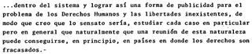 high_r0809_1437_p01.png</a>
<a href="mecanografiados_berrutti/high_r0809_1437_p02.png" title="calidad high, rollo r0809, párrafo 2" style="width:150px;text-align:center;font-size:0.7rem;word-break:break-all;">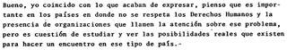 high_r0809_1437_p02.png</a>
<a href="mecanografiados_berrutti/high_r0809_1437_p03.png" title="calidad high, rollo r0809, párrafo 3" style="width:150px;text-align:center;font-size:0.7rem;word-break:break-all;">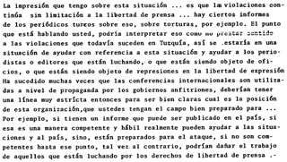 high_r0809_1437_p03.png</a>
<a href="mecanografiados_berrutti/high_r0809_1437_p04.png" title="calidad high, rollo r0809, párrafo 4" style="width:150px;text-align:center;font-size:0.7rem;word-break:break-all;">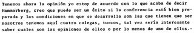 high_r0809_1437_p04.png</a>
<a href="mecanografiados_berrutti/high_r0809_1437_p05.png" title="calidad high, rollo r0809, párrafo 5" style="width:150px;text-align:center;font-size:0.7rem;word-break:break-all;">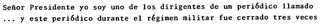 high_r0809_1437_p05.png</a>
<a href="mecanografiados_berrutti/high_r0813_0921_p01.png" title="calidad high, rollo r0813, párrafo 1" style="width:150px;text-align:center;font-size:0.7rem;word-break:break-all;">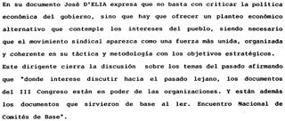 high_r0813_0921_p01.png</a>
<a href="mecanografiados_berrutti/high_r0813_0921_p02.png" title="calidad high, rollo r0813, párrafo 2" style="width:150px;text-align:center;font-size:0.7rem;word-break:break-all;">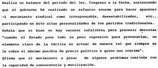 high_r0813_0921_p02.png</a>
<a href="mecanografiados_berrutti/high_r0126_0309_p01.png" title="calidad high, rollo r0126, párrafo 1" style="width:150px;text-align:center;font-size:0.7rem;word-break:break-all;">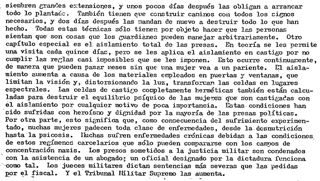 high_r0126_0309_p01.png</a>
<a href="mecanografiados_berrutti/high_r0126_0309_p02.png" title="calidad high, rollo r0126, párrafo 2" style="width:150px;text-align:center;font-size:0.7rem;word-break:break-all;">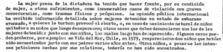 high_r0126_0309_p02.png</a>
<a href="mecanografiados_berrutti/high_r0126_0309_p03.png" title="calidad high, rollo r0126, párrafo 3" style="width:150px;text-align:center;font-size:0.7rem;word-break:break-all;">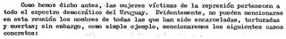 high_r0126_0309_p03.png</a>
<a href="mecanografiados_berrutti/high_r0814_0185_p01.png" title="calidad high, rollo r0814, párrafo 1" style="width:150px;text-align:center;font-size:0.7rem;word-break:break-all;">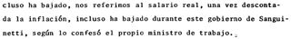 high_r0814_0185_p01.png</a>
<a href="mecanografiados_berrutti/high_r0814_0185_p02.png" title="calidad high, rollo r0814, párrafo 2" style="width:150px;text-align:center;font-size:0.7rem;word-break:break-all;">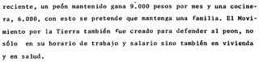 high_r0814_0185_p02.png</a>
<a href="mecanografiados_berrutti/high_r0814_0185_p03.png" title="calidad high, rollo r0814, párrafo 3" style="width:150px;text-align:center;font-size:0.7rem;word-break:break-all;">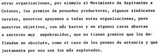 high_r0814_0185_p03.png</a>
<a href="mecanografiados_berrutti/high_r0814_0185_p04.png" title="calidad high, rollo r0814, párrafo 4" style="width:150px;text-align:center;font-size:0.7rem;word-break:break-all;">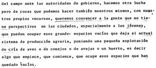 high_r0814_0185_p04.png</a>
<a href="mecanografiados_berrutti/high_r0814_0185_p05.png" title="calidad high, rollo r0814, párrafo 5" style="width:150px;text-align:center;font-size:0.7rem;word-break:break-all;">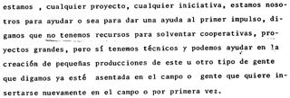 high_r0814_0185_p05.png</a>
<a href="mecanografiados_berrutti/medium_r0463_0417_p01.png" title="calidad medium, rollo r0463, párrafo 1" style="width:150px;text-align:center;font-size:0.7rem;word-break:break-all;"> medium_r0463_0417_p01.png</a>
<a href="mecanografiados_berrutti/medium_r0463_0417_p02.png" title="calidad medium, rollo r0463, párrafo 2" style="width:150px;text-align:center;font-size:0.7rem;word-break:break-all;">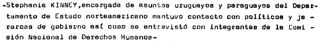 medium_r0463_0417_p02.png</a>
<a href="mecanografiados_berrutti/medium_r0463_0417_p03.png" title="calidad medium, rollo r0463, párrafo 3" style="width:150px;text-align:center;font-size:0.7rem;word-break:break-all;">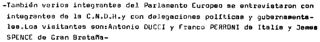 medium_r0463_0417_p03.png</a>
<a href="mecanografiados_berrutti/medium_r0463_0417_p04.png" title="calidad medium, rollo r0463, párrafo 4" style="width:150px;text-align:center;font-size:0.7rem;word-break:break-all;">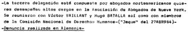 medium_r0463_0417_p04.png</a>
<a href="mecanografiados_berrutti/medium_r0463_0417_p05.png" title="calidad medium, rollo r0463, párrafo 5" style="width:150px;text-align:center;font-size:0.7rem;word-break:break-all;">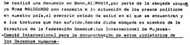 medium_r0463_0417_p05.png</a>
<a href="mecanografiados_berrutti/medium_r0463_0417_p06.png" title="calidad medium, rollo r0463, párrafo 6" style="width:150px;text-align:center;font-size:0.7rem;word-break:break-all;">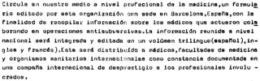 medium_r0463_0417_p06.png</a>
<a href="mecanografiados_berrutti/medium_r0463_0417_p07.png" title="calidad medium, rollo r0463, párrafo 7" style="width:150px;text-align:center;font-size:0.7rem;word-break:break-all;">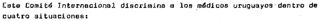 medium_r0463_0417_p07.png</a>
<a href="mecanografiados_berrutti/medium_r0463_0417_p08.png" title="calidad medium, rollo r0463, párrafo 8" style="width:150px;text-align:center;font-size:0.7rem;word-break:break-all;">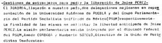 medium_r0463_0417_p08.png</a>
<a href="mecanografiados_berrutti/medium_r0419_1494_p01.png" title="calidad medium, rollo r0419, párrafo 1" style="width:150px;text-align:center;font-size:0.7rem;word-break:break-all;">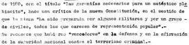 medium_r0419_1494_p01.png</a>
<a href="mecanografiados_berrutti/medium_r0419_1494_p02.png" title="calidad medium, rollo r0419, párrafo 2" style="width:150px;text-align:center;font-size:0.7rem;word-break:break-all;">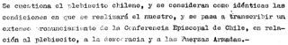 medium_r0419_1494_p02.png</a>
<a href="mecanografiados_berrutti/medium_r0419_1494_p03.png" title="calidad medium, rollo r0419, párrafo 3" style="width:150px;text-align:center;font-size:0.7rem;word-break:break-all;">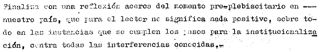 medium_r0419_1494_p03.png</a>
<a href="mecanografiados_berrutti/medium_r0419_1494_p04.png" title="calidad medium, rollo r0419, párrafo 4" style="width:150px;text-align:center;font-size:0.7rem;word-break:break-all;">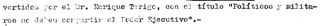 medium_r0419_1494_p04.png</a>
<a href="mecanografiados_berrutti/medium_r0419_1494_p05.png" title="calidad medium, rollo r0419, párrafo 5" style="width:150px;text-align:center;font-size:0.7rem;word-break:break-all;">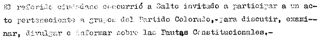 medium_r0419_1494_p05.png</a>
<a href="mecanografiados_berrutti/medium_r0419_1494_p06.png" title="calidad medium, rollo r0419, párrafo 6" style="width:150px;text-align:center;font-size:0.7rem;word-break:break-all;">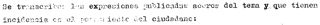 medium_r0419_1494_p06.png</a>
<a href="mecanografiados_berrutti/medium_r0419_1494_p07.png" title="calidad medium, rollo r0419, párrafo 7" style="width:150px;text-align:center;font-size:0.7rem;word-break:break-all;">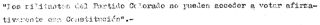 medium_r0419_1494_p07.png</a>
<a href="mecanografiados_berrutti/medium_r0419_1494_p08.png" title="calidad medium, rollo r0419, párrafo 8" style="width:150px;text-align:center;font-size:0.7rem;word-break:break-all;">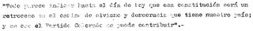 medium_r0419_1494_p08.png</a>
<a href="mecanografiados_berrutti/medium_r0419_1494_p09.png" title="calidad medium, rollo r0419, párrafo 9" style="width:150px;text-align:center;font-size:0.7rem;word-break:break-all;">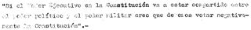 medium_r0419_1494_p09.png</a>
<a href="mecanografiados_berrutti/medium_r0419_1494_p10.png" title="calidad medium, rollo r0419, párrafo 10" style="width:150px;text-align:center;font-size:0.7rem;word-break:break-all;">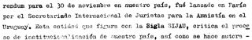 medium_r0419_1494_p10.png</a>
<a href="mecanografiados_berrutti/medium_r0159_2194_p01.png" title="calidad medium, rollo r0159, párrafo 1" style="width:150px;text-align:center;font-size:0.7rem;word-break:break-all;">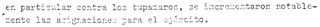 medium_r0159_2194_p01.png</a>
<a href="mecanografiados_berrutti/medium_r0159_2194_p02.png" title="calidad medium, rollo r0159, párrafo 2" style="width:150px;text-align:center;font-size:0.7rem;word-break:break-all;">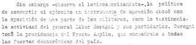 medium_r0159_2194_p02.png</a>
<a href="mecanografiados_berrutti/medium_r0159_2194_p03.png" title="calidad medium, rollo r0159, párrafo 3" style="width:150px;text-align:center;font-size:0.7rem;word-break:break-all;">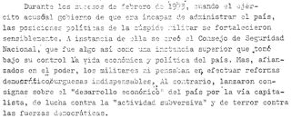 medium_r0159_2194_p03.png</a>
<a href="mecanografiados_berrutti/medium_r0159_2194_p04.png" title="calidad medium, rollo r0159, párrafo 4" style="width:150px;text-align:center;font-size:0.7rem;word-break:break-all;">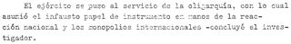 medium_r0159_2194_p04.png</a>
<a href="mecanografiados_berrutti/medium_r0159_2194_p05.png" title="calidad medium, rollo r0159, párrafo 5" style="width:150px;text-align:center;font-size:0.7rem;word-break:break-all;">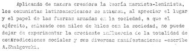 medium_r0159_2194_p05.png</a>
<a href="mecanografiados_berrutti/medium_r0159_2194_p06.png" title="calidad medium, rollo r0159, párrafo 6" style="width:150px;text-align:center;font-size:0.7rem;word-break:break-all;">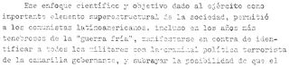 medium_r0159_2194_p06.png</a>
<a href="mecanografiados_berrutti/low_r0577_0176_p01.png" title="calidad low, rollo r0577, párrafo 1" style="width:150px;text-align:center;font-size:0.7rem;word-break:break-all;">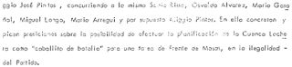 low_r0577_0176_p01.png</a>
<a href="mecanografiados_berrutti/low_r0577_0176_p02.png" title="calidad low, rollo r0577, párrafo 2" style="width:150px;text-align:center;font-size:0.7rem;word-break:break-all;">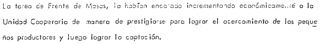 low_r0577_0176_p02.png</a>
<a href="mecanografiados_berrutti/low_r0577_0176_p03.png" title="calidad low, rollo r0577, párrafo 3" style="width:150px;text-align:center;font-size:0.7rem;word-break:break-all;">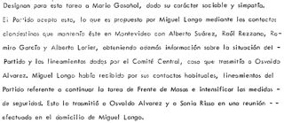 low_r0577_0176_p03.png</a>
<a href="mecanografiados_berrutti/low_r0577_0176_p04.png" title="calidad low, rollo r0577, párrafo 4" style="width:150px;text-align:center;font-size:0.7rem;word-break:break-all;">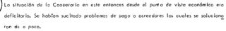 low_r0577_0176_p04.png</a>
<a href="mecanografiados_berrutti/low_r0577_0176_p05.png" title="calidad low, rollo r0577, párrafo 5" style="width:150px;text-align:center;font-size:0.7rem;word-break:break-all;">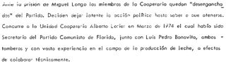 low_r0577_0176_p05.png</a>
<a href="mecanografiados_berrutti/low_r0577_0176_p06.png" title="calidad low, rollo r0577, párrafo 6" style="width:150px;text-align:center;font-size:0.7rem;word-break:break-all;">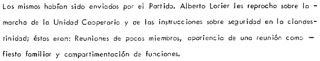 low_r0577_0176_p06.png</a>
<a href="mecanografiados_berrutti/low_r0577_0176_p07.png" title="calidad low, rollo r0577, párrafo 7" style="width:150px;text-align:center;font-size:0.7rem;word-break:break-all;"> low_r0577_0176_p07.png</a>
<a href="mecanografiados_berrutti/low_r0794_1960_p01.png" title="calidad low, rollo r0794, párrafo 1" style="width:150px;text-align:center;font-size:0.7rem;word-break:break-all;">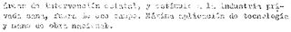 low_r0794_1960_p01.png</a>
<a href="mecanografiados_berrutti/low_r0794_1960_p02.png" title="calidad low, rollo r0794, párrafo 2" style="width:150px;text-align:center;font-size:0.7rem;word-break:break-all;">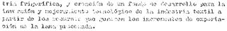 low_r0794_1960_p02.png</a>
<a href="mecanografiados_berrutti/low_r0794_1960_p03.png" title="calidad low, rollo r0794, párrafo 3" style="width:150px;text-align:center;font-size:0.7rem;word-break:break-all;">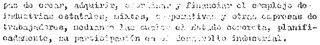 low_r0794_1960_p03.png</a>
<a href="mecanografiados_berrutti/low_r0794_1960_p04.png" title="calidad low, rollo r0794, párrafo 4" style="width:150px;text-align:center;font-size:0.7rem;word-break:break-all;">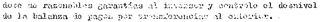 low_r0794_1960_p04.png</a>
<a href="mecanografiados_berrutti/low_r0794_1960_p05.png" title="calidad low, rollo r0794, párrafo 5" style="width:150px;text-align:center;font-size:0.7rem;word-break:break-all;">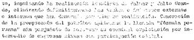 low_r0794_1960_p05.png</a>
<a href="mecanografiados_berrutti/low_r0794_1960_p06.png" title="calidad low, rollo r0794, párrafo 6" style="width:150px;text-align:center;font-size:0.7rem;word-break:break-all;">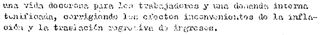 low_r0794_1960_p06.png</a>
<a href="mecanografiados_berrutti/low_r1060-199_p01.png" title="calidad low, rollo r1060, párrafo 1" style="width:150px;text-align:center;font-size:0.7rem;word-break:break-all;"> low_r1060-199_p01.png</a>
<a href="mecanografiados_berrutti/low_r1060-199_p02.png" title="calidad low, rollo r1060, párrafo 2" style="width:150px;text-align:center;font-size:0.7rem;word-break:break-all;"> low_r1060-199_p02.png</a>
<a href="mecanografiados_berrutti/low_r1060-199_p03.png" title="calidad low, rollo r1060, párrafo 3" style="width:150px;text-align:center;font-size:0.7rem;word-break:break-all;"> low_r1060-199_p03.png</a>

## Manuscritos A: siglos XV a XIX

Sentencias, cartas reales, Fuero Juzgo, comentario a Ovidio, Inquisición, inventario (1590), registros notariales (1769) y cartas (1811 y fines del XIX).

**Fuente:** [CHURRO-DS](https://huggingface.co/datasets/stanford-oval/churro-dataset) (Stanford). Licencia de **solo uso de investigación**.

10 imágenes · carpeta [`manuscritos_a_siglos_xv_xix/`](https://github.com/agusnieto77/sicss-uruguay-2026/tree/main/banco_imagenes/manuscritos_a_siglos_xv_xix)

<a href="manuscritos_a_siglos_xv_xix/codea__CODEA-0952.png" title="Legal ruling by Loys de Camañas, judge of Teruel, on March 3, 1460, concerning a hunting dispute involving Joán de la Mata and Daniel de la Mata against Pascual Valero and Marco Miguel over hunting rights in a defended area (deffesa) in Cañadín. The ruling upholds the Mata brothers&#x27; rights based on a privilege granted to their grandmother, Benedita la Mata, and confirmed by King Pedro. Valero and Miguel are ordered to comply and are fined for non-compliance." style="width:150px;text-align:center;font-size:0.7rem;word-break:break-all;"> codea__CODEA-0952.png</a>
<a href="manuscritos_a_siglos_xv_xix/spain__bnf-esp-256_fuero_juzgo_6v.png" title="Excerpt from a medieval Spanish text, likely a legal or religious code, detailing rules of conduct, possibly for rulers or clergy." style="width:150px;text-align:center;font-size:0.7rem;word-break:break-all;"> spain__bnf-esp-256_fuero_juzgo_6v.png</a>
<a href="manuscritos_a_siglos_xv_xix/spain__bnf-esp-533_2r.png" title="Excerpt from a commentary on Ovid&#x27;s Heroides, discussing Penelope and the nature of love, page 2." style="width:150px;text-align:center;font-size:0.7rem;word-break:break-all;"> spain__bnf-esp-533_2r.png</a>
<a href="manuscritos_a_siglos_xv_xix/codea__CODEA-2561.png" title="Legal testimony document from Spanish Inquisition proceedings regarding observance of Islamic practices" style="width:150px;text-align:center;font-size:0.7rem;word-break:break-all;"> codea__CODEA-2561.png</a>
<a href="manuscritos_a_siglos_xv_xix/aldicam__ALDICAM-0487.png" title="Inventory of goods of Catalina de Pontes, widow of Martín González, in Alcorcón, dated February 27, 1590." style="width:150px;text-align:center;font-size:0.7rem;word-break:break-all;"> aldicam__ALDICAM-0487.png</a>
<a href="manuscritos_a_siglos_xv_xix/aldicam__ALDICAM-0550.png" title="Memorial de Joseph Alonso Porrero, escribano, solicitando la tutela y curaduría de Joseph del Pozo, menor de edad, y proponiendo su ingreso en la Casa y seminario de los niños de la Doctrina." style="width:150px;text-align:center;font-size:0.7rem;word-break:break-all;"> aldicam__ALDICAM-0550.png</a>
<a href="manuscritos_a_siglos_xv_xix/notarial__170025120000003_0052.png" title="Page 24 of a register of notarial deeds from Girona, dated July 4, 1769, concerning property sales." style="width:150px;text-align:center;font-size:0.7rem;word-break:break-all;"> notarial__170025120000003_0052.png</a>
<a href="manuscritos_a_siglos_xv_xix/codea__CODEA-3577.png" title="Letter from Francisco Luis de Julian in Vinaroz to Ramon Segura, dated February 6, 1811, concerning the prisoner Rafael Sorolla and personal news." style="width:150px;text-align:center;font-size:0.7rem;word-break:break-all;"> codea__CODEA-3577.png</a>
<a href="manuscritos_a_siglos_xv_xix/aldicam__ALDICAM-0341.png" title="Official communication regarding a revolver found in the City Hall and a request for related investigation documents." style="width:150px;text-align:center;font-size:0.7rem;word-break:break-all;"> aldicam__ALDICAM-0341.png</a>
<a href="manuscritos_a_siglos_xv_xix/notarial__170025120000003_0353.png" title="Notarial deed from Hostalrich, 1769, detailing a property donation to Dr. Franco Antonio Lleopart y de Llança and the creation of a census by Pedro Colomer." style="width:150px;text-align:center;font-size:0.7rem;word-break:break-all;"> notarial__170025120000003_0353.png</a>

## Manuscritos B: siglo XIX

Cartas y notas a una columna, 1818–1897.

**Fuente:** [CHURRO-DS](https://huggingface.co/datasets/stanford-oval/churro-dataset) (Stanford). Licencia de **solo uso de investigación**.

10 imágenes · carpeta [`manuscritos_b_siglo_xix/`](https://github.com/agusnieto77/sicss-uruguay-2026/tree/main/banco_imagenes/manuscritos_b_siglo_xix)

<a href="manuscritos_b_siglo_xix/aldicam__ALDICAM-0005.png" title="A letter of application dated May 20, 1844, from Villa del Prado, written by Don Joaquin Vazquez. He is applying for a teaching position at the elementary school in Aranjuez. He details his qualifications, including being a 23-year-old single man from Villa del Prado, a certified professor from the Normal and Elemental School (having received a superior grade), and having eight months of teaching experience in Val de Santo Domingo. He mentions the support of the local board and parents who entrusted him with their children&#x27;s education." style="width:150px;text-align:center;font-size:0.7rem;word-break:break-all;"> aldicam__ALDICAM-0005.png</a>
<a href="manuscritos_b_siglo_xix/aldicam__ALDICAM-0338.png" title="Official letter from a secretariat, dated March 20, 1874, granting permission to an Ayuntamiento (town council) to hold a bullfight with young bulls (novillos) and two bulls for killing (toretes de muerte). The proceeds are for local charity. The letter emphasizes the need to ensure safety and maintain order." style="width:150px;text-align:center;font-size:0.7rem;word-break:break-all;"> aldicam__ALDICAM-0338.png</a>
<a href="manuscritos_b_siglo_xix/aldicam__ALDICAM-0443.png" title="Nota manuscrita del 21 de julio de 1897, probablemente dejada con una niña abandonada llamada Concepción M. G. La nota indica su fecha de nacimiento (23 de febrero de 1897), que está bautizada, y que sus padres carecen de recursos para criarla pero la recogerán cuando su situación lo permita, presentando un documento similar." style="width:150px;text-align:center;font-size:0.7rem;word-break:break-all;"> aldicam__ALDICAM-0443.png</a>
<a href="manuscritos_b_siglo_xix/codea__CODEA-2600.png" title="Letter dated February 8, 1836, from Zainosa, signed by Juan Vega Verjano, addressed to the Alcaldes of Oliva. The letter requests that two locksmiths be sent to examine firearms related to a homicide investigation concerning Manuel Parron." style="width:150px;text-align:center;font-size:0.7rem;word-break:break-all;"> codea__CODEA-2600.png</a>
<a href="manuscritos_b_siglo_xix/codea__CODEA-2665.png" title="Letter from the Presidency of the Illustrious City Council of Badajoz to Señor D. Bartolomé Belmonte in Cordoba, dated October 16, 1877, regarding a past contribution." style="width:150px;text-align:center;font-size:0.7rem;word-break:break-all;"> codea__CODEA-2665.png</a>
<a href="manuscritos_b_siglo_xix/codea__CODEA-2705.png" title="Personal letter from an unnamed writer to Juan, dated November 28, 1886, from Valladolid. The letter discusses the writer&#x27;s wife&#x27;s illness." style="width:150px;text-align:center;font-size:0.7rem;word-break:break-all;"> codea__CODEA-2705.png</a>
<a href="manuscritos_b_siglo_xix/codea__CODEA-3226.png" title="Personal letter dated Castellon, November 25, 1880, discussing a potential job position and personal matters." style="width:150px;text-align:center;font-size:0.7rem;word-break:break-all;"> codea__CODEA-3226.png</a>
<a href="manuscritos_b_siglo_xix/codea__CODEA-3256.png" title="Letter from Juan Lopez Cancellada to the Duke of Montemar, dated Valladolid, August 3, 1818. The writer explains sending a copy of a response to an accusation by &#x27;el afrancesado Guitar&#x27;, mentions his lack of sleep due to this, and urges the Duke to secure a final resolution for a prolonged matter before the Real Sala, for which a 30-day deadline is approaching." style="width:150px;text-align:center;font-size:0.7rem;word-break:break-all;"> codea__CODEA-3256.png</a>
<a href="manuscritos_b_siglo_xix/codea__CODEA-3317.png" title="Letter requesting payment of two debts, dated Vergara, 12 January 1821." style="width:150px;text-align:center;font-size:0.7rem;word-break:break-all;"> codea__CODEA-3317.png</a>
<a href="manuscritos_b_siglo_xix/codea__CODEA-3440.png" title="Letter from the Military Command of Cati, dated July 8, 1894, to a &quot;Serenisimo Señor&quot; reporting the arrival of twenty-eight volunteers from the 2nd Battalion of Maestrazgo guides, who claim to be deserters. Due to limited forces (three individuals), the sender could not compel them to reason or detain them." style="width:150px;text-align:center;font-size:0.7rem;word-break:break-all;"> codea__CODEA-3440.png</a>

## Manuscritos C: década de 1890

Solicitudes escolares, certificados, cartas, una providencia municipal y un recibo, 1894–1897.

**Fuente:** [CHURRO-DS](https://huggingface.co/datasets/stanford-oval/churro-dataset) (Stanford). Licencia de **solo uso de investigación**.

10 imágenes · carpeta [`manuscritos_c_decada_1890/`](https://github.com/agusnieto77/sicss-uruguay-2026/tree/main/banco_imagenes/manuscritos_c_decada_1890)

<a href="manuscritos_c_decada_1890/aldicam__ALDICAM-0443.png" title="Nota manuscrita del 21 de julio de 1897, probablemente dejada con una niña abandonada llamada Concepción M. G. La nota indica su fecha de nacimiento (23 de febrero de 1897), que está bautizada, y que sus padres carecen de recursos para criarla pero la recogerán cuando su situación lo permita, presentando un documento similar." style="width:150px;text-align:center;font-size:0.7rem;word-break:break-all;"> aldicam__ALDICAM-0443.png</a>
<a href="manuscritos_c_decada_1890/aldicam__ALDICAM-0481.png" title="Official notice (Providencia) and subsequent diligence (Diligencia) issued by the Alcalde of Torrejón de Ardoz concerning the rules of conduct during the festivities of Nuestra Señora del Rosario in October 1896." style="width:150px;text-align:center;font-size:0.7rem;word-break:break-all;"> aldicam__ALDICAM-0481.png</a>
<a href="manuscritos_c_decada_1890/codea__CODEA-2993.png" title="Letter from Juan Ruiz Mateo to the Director of the Colegio de 2ª enseñanza in Albox, requesting admission for examination for the first group of Bachillerato. The letter is dated Albox, September 24, 1897. A marginal note indicates approval by the Director." style="width:150px;text-align:center;font-size:0.7rem;word-break:break-all;"> codea__CODEA-2993.png</a>
<a href="manuscritos_c_decada_1890/codea__CODEA-2994.png" title="Formal request (instancia) by Ananías Vicente Salaserri y Sierra to the Director of the Provincial Institute of Secondary Education of Almería, dated September 27, 1897, petitioning for admission to the entrance examinations for secondary education." style="width:150px;text-align:center;font-size:0.7rem;word-break:break-all;"> codea__CODEA-2994.png</a>
<a href="manuscritos_c_decada_1890/codea__CODEA-2996.png" title="Letter of application from José Emilio Viciana Viciana to the Director of the Provincial Institute of Secondary Education of Almería, requesting admission to examinations. Dated Rágol, April 29, 1898." style="width:150px;text-align:center;font-size:0.7rem;word-break:break-all;"> codea__CODEA-2996.png</a>
<a href="manuscritos_c_decada_1890/codea__CODEA-2997.png" title="Letter of application from Cayetano Acuña Gutierres to the Director of the Provincial Institute for admission to second-grade studies, dated September 17, 1898, Almeria." style="width:150px;text-align:center;font-size:0.7rem;word-break:break-all;"> codea__CODEA-2997.png</a>
<a href="manuscritos_c_decada_1890/codea__CODEA-2999.png" title="Certificate of examination results for Marcos Sanchez Sanchez from the Colegio de 2ª Enseñanza de la Purisima Concepcion in Huercal-Overa, dated September 30, 1898." style="width:150px;text-align:center;font-size:0.7rem;word-break:break-all;"> codea__CODEA-2999.png</a>
<a href="manuscritos_c_decada_1890/codea__CODEA-3186.png" title="Recibo por obras de albañilería realizadas en la casa de la Señora de Mendoza, por un total de 308 reales, fechado en San Ildefonso en julio de 1893. El albañil es Aniceto Gomez." style="width:150px;text-align:center;font-size:0.7rem;word-break:break-all;"> codea__CODEA-3186.png</a>
<a href="manuscritos_c_decada_1890/codea__CODEA-3227.png" title="Letter from journalists residing in Melilla to Don Emilio Diaz Moreu, Commander of the cruiser &quot;Conde del Venadito&quot;, congratulating him and the Spanish Navy, dated October 21, 1893." style="width:150px;text-align:center;font-size:0.7rem;word-break:break-all;"> codea__CODEA-3227.png</a>
<a href="manuscritos_c_decada_1890/codea__CODEA-3440.png" title="Letter from the Military Command of Cati, dated July 8, 1894, to a &quot;Serenisimo Señor&quot; reporting the arrival of twenty-eight volunteers from the 2nd Battalion of Maestrazgo guides, who claim to be deserters. Due to limited forces (three individuals), the sender could not compel them to reason or detain them." style="width:150px;text-align:center;font-size:0.7rem;word-break:break-all;"> codea__CODEA-3440.png</a>

## Impresos a una columna

Páginas impresas en español a una sola columna, siglos XVI a XIX: pliegos de cordel, libros del siglo XIX y textos de los siglos XVI a XVIII.

**Fuente:** [CHURRO-DS](https://huggingface.co/datasets/stanford-oval/churro-dataset) (Stanford). Licencia de **solo uso de investigación**.

20 imágenes · carpeta [`impresos_una_columna/`](https://github.com/agusnieto77/sicss-uruguay-2026/tree/main/banco_imagenes/impresos_una_columna)

<a href="impresos_una_columna/fondue-chapbooks__Varios_435_15.png" title="Page from a Spanish chapbook detailing events from the life of Jacob and Joseph." style="width:150px;text-align:center;font-size:0.7rem;word-break:break-all;"> fondue-chapbooks__Varios_435_15.png</a>
<a href="impresos_una_columna/fondue-chapbooks__Varios_435_16.png" title="Narrative concerning the final days and legacy of Joseph in Egypt." style="width:150px;text-align:center;font-size:0.7rem;word-break:break-all;"> fondue-chapbooks__Varios_435_16.png</a>
<a href="impresos_una_columna/fondue-chapbooks__Varios_435_6.png" title="Page from a Spanish chapbook." style="width:150px;text-align:center;font-size:0.7rem;word-break:break-all;"> fondue-chapbooks__Varios_435_6.png</a>
<a href="impresos_una_columna/fondue-es-print-19__antonio_jose_valdes_delirio_1816_Delirio_I__en_La_prensa_argentina_18_jun_1816_page-0006.png" title="Text discussing social order and public works, possibly from a narrative or commentary." style="width:150px;text-align:center;font-size:0.7rem;word-break:break-all;"> fondue-es-print-19__antonio_jose_valdes_delirio_1816_Delirio_I__en_La_prensa_argentina_18_jun_1816_page-0006.png</a>
<a href="impresos_una_columna/fondue-es-print-19__antonio_jose_valdes_delirio_1816_Delirio_I__en_La_prensa_argentina_18_jun_1816_page-0008.png" title="Fragment of a narrative text." style="width:150px;text-align:center;font-size:0.7rem;word-break:break-all;"> fondue-es-print-19__antonio_jose_valdes_delirio_1816_Delirio_I__en_La_prensa_argentina_18_jun_1816_page-0008.png</a>
<a href="impresos_una_columna/fondue-es-print-19__antonio_jose_valdes_delirio_ii_Delirio_II__en_La_prensa_argentina_18_jun_1816_page-0002.png" title="Excerpt from a narrative text, page 2, with a handwritten annotation &quot;78&quot; in the margin." style="width:150px;text-align:center;font-size:0.7rem;word-break:break-all;"> fondue-es-print-19__antonio_jose_valdes_delirio_ii_Delirio_II__en_La_prensa_argentina_18_jun_1816_page-0002.png</a>
<a href="impresos_una_columna/fondue-es-print-19__antonio_jose_valdes_delirio_ii_Delirio_II__en_La_prensa_argentina_18_jun_1816_page-0008.png" title="fondue-es-print-19/antonio_jose_valdes_delirio_ii_Delirio II, en La prensa argentina 18 jun 1816_page-0008" style="width:150px;text-align:center;font-size:0.7rem;word-break:break-all;"> fondue-es-print-19__antonio_jose_valdes_delirio_ii_Delirio_II__en_La_prensa_argentina_18_jun_1816_page-0008.png</a>
<a href="impresos_una_columna/fondue-es-print-19__aquiles_sioen_buenos_aires_en_el_buenos_aires_en_el_ano_2080_pdf_page_24.png" title="Excerpt from a book discussing celibacy and societal development in a future Buenos Aires." style="width:150px;text-align:center;font-size:0.7rem;word-break:break-all;"> fondue-es-print-19__aquiles_sioen_buenos_aires_en_el_buenos_aires_en_el_ano_2080_pdf_page_24.png</a>
<a href="impresos_una_columna/fondue-es-print-19__aquiles_sioen_buenos_aires_en_el_buenos_aires_en_el_ano_2080_pdf_page_69.png" title="Excerpt from a narrative text, likely a novel or story, featuring dialogue." style="width:150px;text-align:center;font-size:0.7rem;word-break:break-all;"> fondue-es-print-19__aquiles_sioen_buenos_aires_en_el_buenos_aires_en_el_ano_2080_pdf_page_69.png</a>
<a href="impresos_una_columna/fondue-es-print-19__eduardo_l_holmberg_horacio_horaciokalibangolosautomatas_pdf_page_12.png" title="Page from a Spanish novel, likely 19th century." style="width:150px;text-align:center;font-size:0.7rem;word-break:break-all;"> fondue-es-print-19__eduardo_l_holmberg_horacio_horaciokalibangolosautomatas_pdf_page_12.png</a>
<a href="impresos_una_columna/fondue-es-print-19__juan_egana_progresos_de_la_civilizacion_ocios_filosoficos_y_poeticos_ixe4bcu_pdf_page_85.png" title="Excerpt from a philosophical dialogue or essay titled &quot;NOCHE QUINTA&quot;." style="width:150px;text-align:center;font-size:0.7rem;word-break:break-all;"> fondue-es-print-19__juan_egana_progresos_de_la_civilizacion_ocios_filosoficos_y_poeticos_ixe4bcu_pdf_page_85.png</a>
<a href="impresos_una_columna/fondue-es-print-19__julian_m_del_portillo_lima_de_lima_de_aqui_a_cien_anos_pdf_page_33.png" title="A narrative passage describing an emotional scene and subsequent actions." style="width:150px;text-align:center;font-size:0.7rem;word-break:break-all;"> fondue-es-print-19__julian_m_del_portillo_lima_de_lima_de_aqui_a_cien_anos_pdf_page_33.png</a>
<a href="impresos_una_columna/fondue-es-print-19__perez_galdos_luchana_perez_galdos_luchana_8.png" title="Page 8 of a narrative text by B. Pérez Galdós, describing a military scene and a subsequent summons." style="width:150px;text-align:center;font-size:0.7rem;word-break:break-all;"> fondue-es-print-19__perez_galdos_luchana_perez_galdos_luchana_8.png</a>
<a href="impresos_una_columna/fondue-es-print-19__perez_galdos_luchana_perez_galdos_luchana_9.png" title="fondue-es-print-19/perez_galdos_luchana_perez_galdos_luchana_9" style="width:150px;text-align:center;font-size:0.7rem;word-break:break-all;"> fondue-es-print-19__perez_galdos_luchana_perez_galdos_luchana_9.png</a>
<a href="impresos_una_columna/fondue-es-print-19__ricardo_palma_apocaliptica_1883_Ricardo_Palma_-_Apocaliptica.png" title="Chapter XII, &quot;Apocalíptica,&quot; from a work by Ricardo Palma." style="width:150px;text-align:center;font-size:0.7rem;word-break:break-all;"> fondue-es-print-19__ricardo_palma_apocaliptica_1883_Ricardo_Palma_-_Apocaliptica.png</a>
<a href="impresos_una_columna/impact__00442648.png" title="A page from a book discussing matters of faith and reason, and a personal dilemma." style="width:150px;text-align:center;font-size:0.7rem;word-break:break-all;"> impact__00442648.png</a>
<a href="impresos_una_columna/impact__00442752.png" title="Page from a historical book, likely part of a larger narrative." style="width:150px;text-align:center;font-size:0.7rem;word-break:break-all;"> impact__00442752.png</a>
<a href="impresos_una_columna/impact__00443023.png" title="Page 12 of &quot;Subida del monte Carmelo&quot;." style="width:150px;text-align:center;font-size:0.7rem;word-break:break-all;"> impact__00443023.png</a>
<a href="impresos_una_columna/salamanca__W0015_page019.png" title="Fragment of a religious instructional text regarding confession and sin, referencing Saint Augustine." style="width:150px;text-align:center;font-size:0.7rem;word-break:break-all;"> salamanca__W0015_page019.png</a>
<a href="impresos_una_columna/salamanca__W0015_page024.png" title="Excerpt from a religious text discussing the third commandment, focusing on sanctifying feast days and related obligations." style="width:150px;text-align:center;font-size:0.7rem;word-break:break-all;"> salamanca__W0015_page024.png</a>

## Prensa marítima (PortADa)

Columnas y páginas de prensa rioplatense y española, 1851–1910, con noticias de entradas y salidas de buques.

**Fuente:** Proyecto PortADa. Consultar al proyecto antes de reutilizarlas.

46 imágenes · carpeta [`prensa_portada/`](https://github.com/agusnieto77/sicss-uruguay-2026/tree/main/banco_imagenes/prensa_portada)

<a href="prensa_portada/13_pag_3_maritima_recorte.png" title="fuente: other" style="width:150px;text-align:center;font-size:0.7rem;word-break:break-all;"> 13_pag_3_maritima_recorte.png</a>
<a href="prensa_portada/1853_02_18_FIA_dl_10000032242_DiarioDeBarcelonaAno1853No0491.jpg" title="fuente: other" style="width:150px;text-align:center;font-size:0.7rem;word-break:break-all;"> 1853_02_18_FIA_dl_10000032242_DiarioDeBarcelonaAno1853No0491.jpg</a>
<a href="prensa_portada/19000722_4.jpg" title="fuente: diario_1900" style="width:150px;text-align:center;font-size:0.7rem;word-break:break-all;"> 19000722_4.jpg</a>
<a href="prensa_portada/19000722_6.jpg" title="fuente: diario_1900" style="width:150px;text-align:center;font-size:0.7rem;word-break:break-all;"> 19000722_6.jpg</a>
<a href="prensa_portada/19000723_3.jpg" title="fuente: diario_1900" style="width:150px;text-align:center;font-size:0.7rem;word-break:break-all;"> 19000723_3.jpg</a>
<a href="prensa_portada/19000724_5.jpg" title="fuente: diario_1900" style="width:150px;text-align:center;font-size:0.7rem;word-break:break-all;"> 19000724_5.jpg</a>
<a href="prensa_portada/19000725_2.jpg" title="fuente: diario_1900" style="width:150px;text-align:center;font-size:0.7rem;word-break:break-all;"> 19000725_2.jpg</a>
<a href="prensa_portada/19000725_4.jpg" title="fuente: diario_1900" style="width:150px;text-align:center;font-size:0.7rem;word-break:break-all;"> 19000725_4.jpg</a>
<a href="prensa_portada/19000725_6.jpg" title="fuente: diario_1900" style="width:150px;text-align:center;font-size:0.7rem;word-break:break-all;"> 19000725_6.jpg</a>
<a href="prensa_portada/19000726_2.jpg" title="fuente: diario_1900" style="width:150px;text-align:center;font-size:0.7rem;word-break:break-all;"> 19000726_2.jpg</a>
<a href="prensa_portada/19000728_1.jpg" title="fuente: diario_1900" style="width:150px;text-align:center;font-size:0.7rem;word-break:break-all;"> 19000728_1.jpg</a>
<a href="prensa_portada/19000728_3.jpg" title="fuente: diario_1900" style="width:150px;text-align:center;font-size:0.7rem;word-break:break-all;"> 19000728_3.jpg</a>
<a href="prensa_portada/19000730_2.jpg" title="fuente: diario_1900" style="width:150px;text-align:center;font-size:0.7rem;word-break:break-all;"> 19000730_2.jpg</a>
<a href="prensa_portada/BNA_S001196977_18511225N8441.png" title="fuente: gaceta_1851" style="width:150px;text-align:center;font-size:0.7rem;word-break:break-all;"> BNA_S001196977_18511225N8441.png</a>
<a href="prensa_portada/BNA_S001196977_18511227N8443.png" title="fuente: gaceta_1851" style="width:150px;text-align:center;font-size:0.7rem;word-break:break-all;"> BNA_S001196977_18511227N8443.png</a>
<a href="prensa_portada/BNA_S001196977_18511230N8445.png" title="fuente: gaceta_1851" style="width:150px;text-align:center;font-size:0.7rem;word-break:break-all;"> BNA_S001196977_18511230N8445.png</a>
<a href="prensa_portada/BNA_S001196977_18511231N8446.png" title="fuente: gaceta_1851" style="width:150px;text-align:center;font-size:0.7rem;word-break:break-all;"> BNA_S001196977_18511231N8446.png</a>
<a href="prensa_portada/BNA_S001196977_18520102N8447.png" title="fuente: gaceta_1851" style="width:150px;text-align:center;font-size:0.7rem;word-break:break-all;"> BNA_S001196977_18520102N8447.png</a>
<a href="prensa_portada/BNA_S001196977_18520112N8455.png" title="fuente: gaceta_1851" style="width:150px;text-align:center;font-size:0.7rem;word-break:break-all;"> BNA_S001196977_18520112N8455.png</a>
<a href="prensa_portada/BNA_S001196977_18520117N8460.png" title="fuente: gaceta_1851" style="width:150px;text-align:center;font-size:0.7rem;word-break:break-all;"> BNA_S001196977_18520117N8460.png</a>
<a href="prensa_portada/BNA_S001196977_18520124N8466.png" title="fuente: gaceta_1851" style="width:150px;text-align:center;font-size:0.7rem;word-break:break-all;"> BNA_S001196977_18520124N8466.png</a>
<a href="prensa_portada/BNA_S001196977_18520128N8469.png" title="fuente: gaceta_1851" style="width:150px;text-align:center;font-size:0.7rem;word-break:break-all;"> BNA_S001196977_18520128N8469.png</a>
<a href="prensa_portada/BNA_S001196977_18520129N8470.png" title="fuente: gaceta_1851" style="width:150px;text-align:center;font-size:0.7rem;word-break:break-all;"> BNA_S001196977_18520129N8470.png</a>
<a href="prensa_portada/BNA_S001196977_18520130N8471.png" title="fuente: gaceta_1851" style="width:150px;text-align:center;font-size:0.7rem;word-break:break-all;"> BNA_S001196977_18520130N8471.png</a>
<a href="prensa_portada/BNA_S001196977_18520131N8472.png" title="fuente: gaceta_1851" style="width:150px;text-align:center;font-size:0.7rem;word-break:break-all;"> BNA_S001196977_18520131N8472.png</a>
<a href="prensa_portada/IMG_20231229_133240518_MFNR.jpg" title="fuente: phone_photo" style="width:150px;text-align:center;font-size:0.7rem;word-break:break-all;"> IMG_20231229_133240518_MFNR.jpg</a>
<a href="prensa_portada/IMG_20231229_134611768_MFNR.jpg" title="fuente: phone_photo" style="width:150px;text-align:center;font-size:0.7rem;word-break:break-all;"> IMG_20231229_134611768_MFNR.jpg</a>
<a href="prensa_portada/IMG_20231229_135250146_MFNR.jpg" title="fuente: phone_photo" style="width:150px;text-align:center;font-size:0.7rem;word-break:break-all;"> IMG_20231229_135250146_MFNR.jpg</a>
<a href="prensa_portada/LN_1880-12-01_p2_A.png" title="fuente: la_nacion_1880" style="width:150px;text-align:center;font-size:0.7rem;word-break:break-all;"> LN_1880-12-01_p2_A.png</a>
<a href="prensa_portada/LN_1880-12-18_p2_C.png" title="fuente: la_nacion_1880" style="width:150px;text-align:center;font-size:0.7rem;word-break:break-all;"> LN_1880-12-18_p2_C.png</a>
<a href="prensa_portada/LN_1880-12-19_p2_A.png" title="fuente: la_nacion_1880" style="width:150px;text-align:center;font-size:0.7rem;word-break:break-all;"> LN_1880-12-19_p2_A.png</a>
<a href="prensa_portada/QP5K663Y5AL5GPK8PHLFFSUNV7XKTI_Pagina_3crop.png" title="fuente: other" style="width:150px;text-align:center;font-size:0.7rem;word-break:break-all;"> QP5K663Y5AL5GPK8PHLFFSUNV7XKTI_Pagina_3crop.png</a>
<a href="prensa_portada/RECORTE_LA_PRENSA___June_7_1910_Pagina_15.png" title="fuente: la_prensa" style="width:150px;text-align:center;font-size:0.7rem;word-break:break-all;"> RECORTE_LA_PRENSA___June_7_1910_Pagina_15.png</a>
<a href="prensa_portada/TBP_AN_1856-11-29_n_1571_Pagina_3.png" title="fuente: other" style="width:150px;text-align:center;font-size:0.7rem;word-break:break-all;"> TBP_AN_1856-11-29_n_1571_Pagina_3.png</a>
<a href="prensa_portada/TBPAN.png" title="fuente: other" style="width:150px;text-align:center;font-size:0.7rem;word-break:break-all;"> TBPAN.png</a>
<a href="prensa_portada/el_cronista__Pagina_3.jpg" title="fuente: other" style="width:150px;text-align:center;font-size:0.7rem;word-break:break-all;"> el_cronista__Pagina_3.jpg</a>
<a href="prensa_portada/el_nacional_1853_05_27.png" title="fuente: el_nacional_1850s" style="width:150px;text-align:center;font-size:0.7rem;word-break:break-all;"> el_nacional_1853_05_27.png</a>
<a href="prensa_portada/el_nacional_1856-04-19_Pagina_3a.png" title="fuente: el_nacional_1850s" style="width:150px;text-align:center;font-size:0.7rem;word-break:break-all;"> el_nacional_1856-04-19_Pagina_3a.png</a>
<a href="prensa_portada/el_nacional_1856-04-19_Pagina_3b.png" title="fuente: el_nacional_1850s" style="width:150px;text-align:center;font-size:0.7rem;word-break:break-all;"> el_nacional_1856-04-19_Pagina_3b.png</a>
<a href="prensa_portada/el_nacional_1857_01_31_Pagina_3.png" title="fuente: el_nacional_1850s" style="width:150px;text-align:center;font-size:0.7rem;word-break:break-all;"> el_nacional_1857_01_31_Pagina_3.png</a>
<a href="prensa_portada/el_nacional_1857_02_07.png" title="fuente: el_nacional_1850s" style="width:150px;text-align:center;font-size:0.7rem;word-break:break-all;"> el_nacional_1857_02_07.png</a>
<a href="prensa_portada/la_prensa_1902.jpg" title="fuente: la_prensa" style="width:150px;text-align:center;font-size:0.7rem;word-break:break-all;"> la_prensa_1902.jpg</a>
<a href="prensa_portada/la_prensa_1909a.jpg" title="fuente: la_prensa" style="width:150px;text-align:center;font-size:0.7rem;word-break:break-all;"> la_prensa_1909a.jpg</a>
<a href="prensa_portada/la_prensa_1909b.jpg" title="fuente: la_prensa" style="width:150px;text-align:center;font-size:0.7rem;word-break:break-all;"> la_prensa_1909b.jpg</a>
<a href="prensa_portada/la_prensa_1909c.jpg" title="fuente: la_prensa" style="width:150px;text-align:center;font-size:0.7rem;word-break:break-all;"> la_prensa_1909c.jpg</a>
<a href="prensa_portada/recorte_muestra_LP_1870.jpg" title="fuente: la_prensa" style="width:150px;text-align:center;font-size:0.7rem;word-break:break-all;"> recorte_muestra_LP_1870.jpg</a>

